# Hey there! I'm Lucas 👋

I'm a Full-Stack Web Developer passionate about building modern web applications. I enjoy working across both front-end and back-end environments, exploring new technologies, and collaborating on new projects.

## Skills & Technologies

Here are some of the languages & technologies I use to develop my applications.

### Languages

### Technologies

### Specialties

## Education

I'm currently pursuing a diploma in Full-Stack Website Development to strengthen my knowledge of modern web technologies & software engineering.

## Let's Connect

- 📧 [Contact Me](https://lucastranks.com/contact)
- 🌐 [My Website](https://lucastranks.com)
- 💼 [LinkedIn](https://www.linkedin.com/in/lucas-stranks/)
